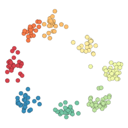
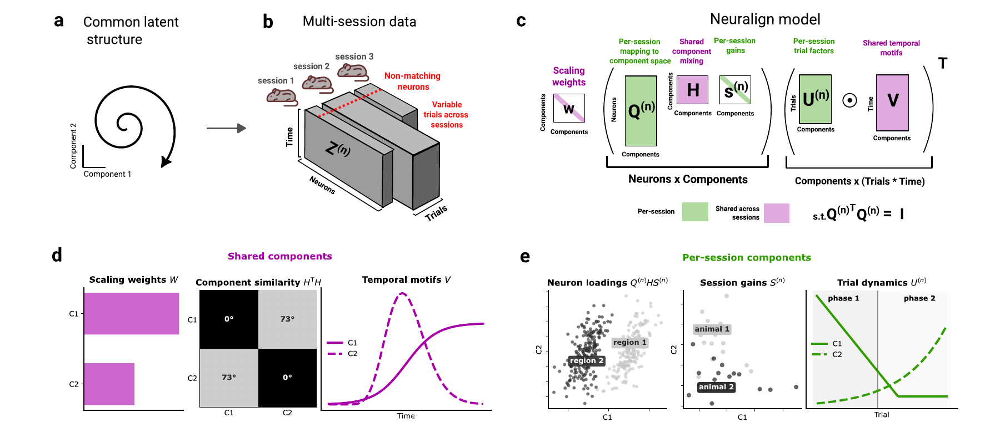

#  Neuralign

Find shared activity patterns across neural recordings, with a factor for each neuron and each trial.

[](https://raw.githubusercontent.com/MiklosKralik/neuralign/main/docs/assets/neuralign-overview.pdf)

## Install

Python 3.10 or later. From PyPI, after the first release:

```bash
python -m pip install neuralign
```

Or directly from GitHub:

```bash
python -m pip install git+https://github.com/MiklosKralik/neuralign.git
```

## Quickstart

This example generates its own data:

```python
from neuralign import NeuralignModel
from neuralign.simulation import simulate_sessions

sessions, _ = simulate_sessions(seed=42)
factors = NeuralignModel(sessions, rank=2, max_iter=500, seed=42).fit("cpu")

time_factors = factors.V                       # time × components
neuron_factors = factors[0].neuron_factors       # neurons × components
trial_factors = factors[0].trial_factors         # trials × components
```

For your own recordings, pass a list of arrays in **neurons × time × trials** order. Sessions may have different neuron and trial counts, but must share time bins.

[Documentation](https://mikloskralik.github.io/neuralign/) · [Use your recordings](https://mikloskralik.github.io/neuralign/getting-started.html) · [Plotting example](https://github.com/MiklosKralik/neuralign/blob/main/examples/quickstart.py)

## Paper

Neuralign is described in *Identifying aligned tensor decompositions across heterogeneous neural datasets*.

Please cite the software and manuscript when using Neuralign in research. [Citation](https://github.com/MiklosKralik/neuralign/blob/main/CITATION.cff) · [MIT License](https://github.com/MiklosKralik/neuralign/blob/main/LICENSE).
