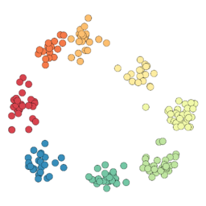
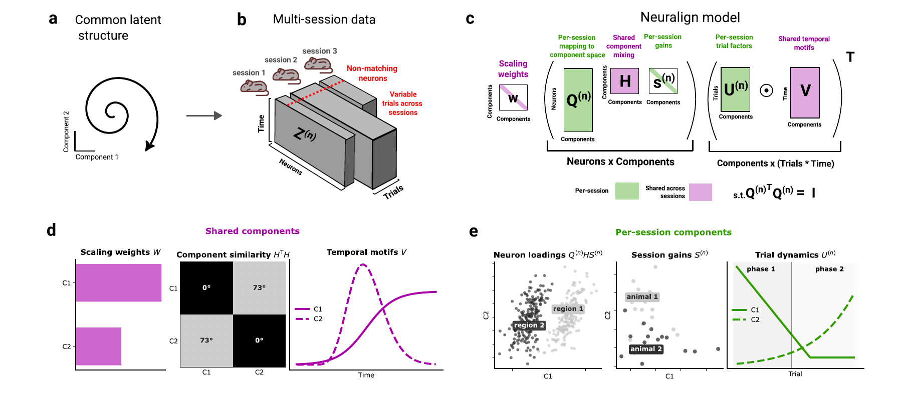
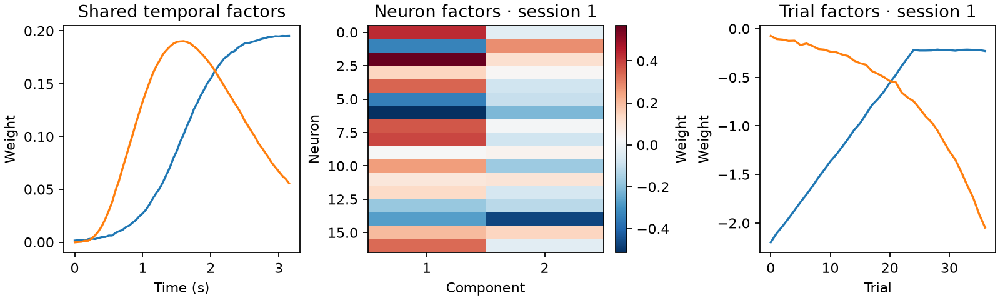

#  Neuralign

Find shared activity patterns across neural recordings, with a factor for each neuron and each trial.

[](assets/neuralign-overview.pdf)

## Quickstart

This example generates its own data:

```python
from neuralign import NeuralignModel
from neuralign.simulation import simulate_sessions

sessions, _ = simulate_sessions(seed=42)
factors = NeuralignModel(sessions, rank=2, max_iter=500, seed=42).fit("cpu")

time_factors = factors.V                       # time × components
neuron_factors = factors[0].neuron_factors       # neurons × components
trial_factors = factors[0].trial_factors         # trials × components
```

For your own recordings, pass a list of arrays in **neurons × time × trials** order. Sessions may have different neuron and trial counts, but must share time bins.

[Model and outputs](model-and-outputs.md) · [Use your recordings](getting-started.md)

## See the factors

The fit separates shared time courses from neuron weights and trial-to-trial changes:



Plot the quickstart's factors with Matplotlib:

```python
import matplotlib.pyplot as plt

fig, axes = plt.subplots(1, 3, figsize=(10, 3), layout="constrained")
axes[0].plot(time_factors.detach().numpy())
axes[0].set_title("Shared time courses")
axes[1].imshow(neuron_factors.detach().numpy(), aspect="auto", cmap="RdBu_r")
axes[1].set_title("Neuron weights")
axes[2].plot(trial_factors.detach().numpy())
axes[2].set_title("Trial weights")
plt.show()
```

Read left to right: when each component is active, which neurons contribute, and how its strength varies across trials. [Full example with axis labels](https://github.com/MiklosKralik/neuralign/blob/main/examples/quickstart.py).

## Install

Python 3.10+; GPU fitting is recommended for larger datasets (use `fit("cuda")`).

```bash
python -m pip install neuralign
```

For CPU-only installation, install CPU PyTorch first:

```bash
python -m pip install "torch>=2.9.1" --index-url https://download.pytorch.org/whl/cpu
python -m pip install neuralign
```

For plotting, add Matplotlib: `python -m pip install matplotlib`.

## Paper

Neuralign is described in [*Identifying aligned tensor decompositions across heterogeneous neural datasets*](https://doi.org/10.64898/2026.11.12.766278) (bioRxiv, 2026).

Please cite the software and manuscript when using Neuralign in research. [Citation](https://github.com/MiklosKralik/neuralign/blob/main/CITATION.cff) · [MIT License](https://github.com/MiklosKralik/neuralign/blob/main/LICENSE).
